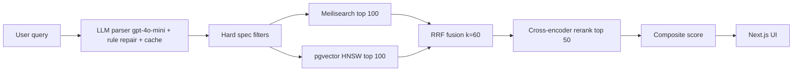

# lmsearch — AI Natural-Language Product Search Engine

> Rebuilt from the original 2024 lmsearch project; commit dates reflect the original development timeline.

Type a free-form request like *"Ryzen laptop with 32GB RAM under $1200 for programming"* or
*"gaming phone, 120Hz screen, 5000mAh battery, below 40k BDT"* and get ranked product cards
with match explanations.

## Architecture



See `docs/architecture.md`, `docs/ranking.md`, `docs/api.md`.

## Setup (`make up`)

```bash
cp .env.example .env        # set OPENAI_API_KEY + ADMIN_API_KEY
make up                     # postgres + redis + meilisearch + api
make seed                   # load 600 demo products
make reindex                # build keyword + vector indexes
# web
cd apps/web && npm install && npm run dev
```

Seeded demo runs with no scraping and no GPU: embeddings/reranker fall back to
deterministic lexical scoring unless `LMSEARCH_USE_HF_EMBEDDINGS=1` / `LMSEARCH_USE_HF_RERANKER=1`.

## API quickstart

```bash
curl -X POST localhost:8000/api/v1/search -H 'Content-Type: application/json' \
  -d '{"query":"Ryzen laptop 32GB RAM under $1200","limit":5}'
```

## Eval

```bash
pytest -q
python ml/evaluate.py   # parser ≥90% gate, Precision@10, nDCG@10
```

## Roadmap
- [ ] Playwright JS-rendered spiders for top BD/US stores
- [ ] Price-drop alerts + search-log click models
- [ ] Multilingual (Bangla) embeddings + voice search
- [ ] Kubernetes manifests + staging env
