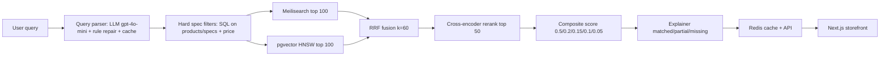

# Architecture

## Services
- `apps/api/app/services/query_parser.py` rule layer; `llm_parser.py` provider interface (openai/ollama, 2s timeout, fallback).
- `spec_normalizer.py` shared with ingest; `currency.py` k/lakh/BDT/৳; `query_parser_bn.py` Bangla-English.
- `keyword_search.py` Meilisearch + in-memory fallback; `vector_search.py` pgvector HNSW + cosine fallback.
- `hybrid.py` parallel fetch + RRF; `reranker.py` bge-reranker-base toggle; `explainer.py` composite scoring.
- `filters.py` hard filters + progressive relaxation (brand → price+20% → refresh/battery → storage → ram → cpu).
- `catalog.py` seed catalog (600 products) when Postgres is absent; `core/cache.py` Redis + LRU.

## Data
PostgreSQL 16 + pgvector (`vector(384)`, HNSW m=16/ef=64), GIN on title, B-tree on price, composite (key, value_num).
Meilisearch `products` index; Redis for parsed-query (1h) and result (5min) caches.
